# HyperCare

Sistem pakar untuk membantu diagnosis hipertensi pada ibu hamil.

[](https://www.php.net/)
[](https://laravel.com/)
[](https://www.mysql.com/)
[](https://getbootstrap.com/)

Repository: [sistem-pakar-diagnosis-penyakit-hipertensi-pada-ibu-hamil](https://github.com/IrvanAfriandi/sistem-pakar-diagnosis-penyakit-hipertensi-pada-ibu-hamil)

## Tentang Proyek

HyperCare adalah aplikasi sistem pakar untuk membantu proses diagnosis penyakit terkait hipertensi pada ibu hamil. Aplikasi ini menyediakan alur konsultasi publik serta panel admin dan petugas untuk mengelola data pasien, penyakit, gejala, dan basis pengetahuan. Project dibangun dengan Laravel 10, PHP, dan database relasional.

## Fitur Utama

- Dashboard statistik konsultasi dan data kesehatan.
- Manajemen pasien, pengguna, penyakit, dan gejala.
- Basis pengetahuan dengan nilai Certainty Factor.
- Alur konsultasi publik berbasis tingkat gejala.
- Hasil diagnosis dengan tingkat keyakinan.
- Riwayat konsultasi dan ekspor laporan.

## Tampilan Aplikasi

<p align="center">
  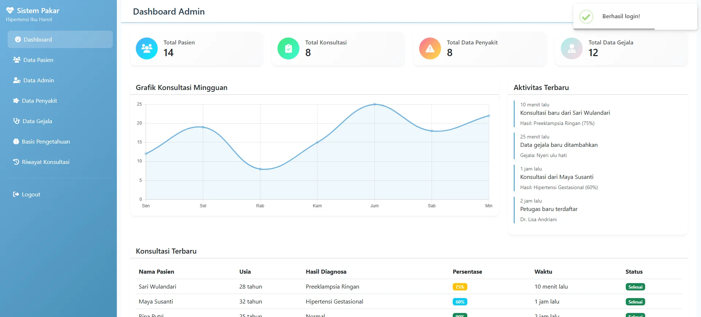
  <br>
  Dashboard admin menampilkan statistik pasien, konsultasi, penyakit, dan gejala.
</p>

<table>
  <tr>
    <td align="center" width="50%">
      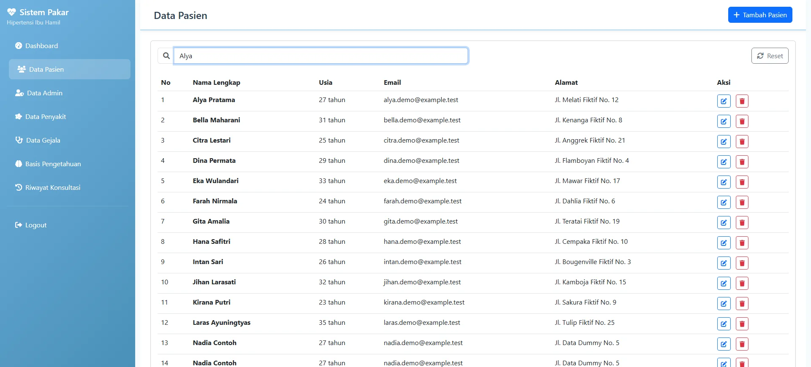
      <br>Daftar pasien dummy dengan pencarian nama aktif.
    </td>
    <td align="center" width="50%">
      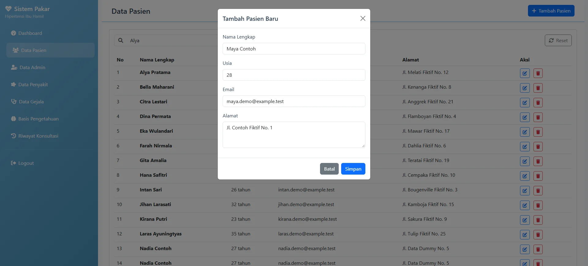
      <br>Form tambah pasien terisi data contoh di dalam modal.
    </td>
  </tr>
  <tr>
    <td align="center">
      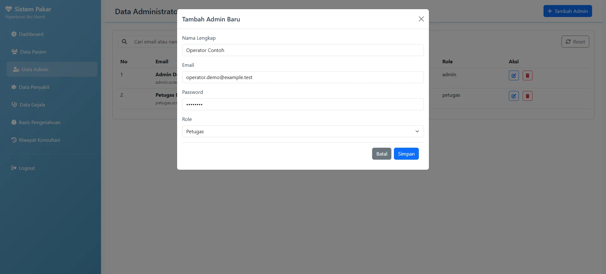
      <br>Form manajemen pengguna untuk menetapkan role admin atau petugas.
    </td>
    <td align="center">
      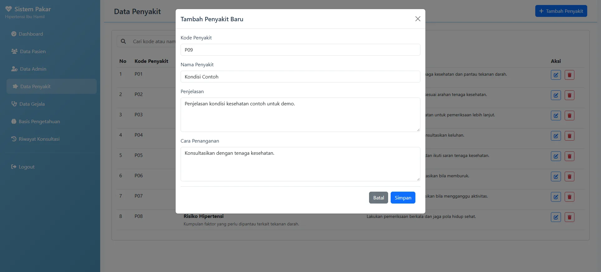
      <br>Daftar penyakit dan form tambah kondisi kesehatan contoh.
    </td>
  </tr>
  <tr>
    <td align="center">
      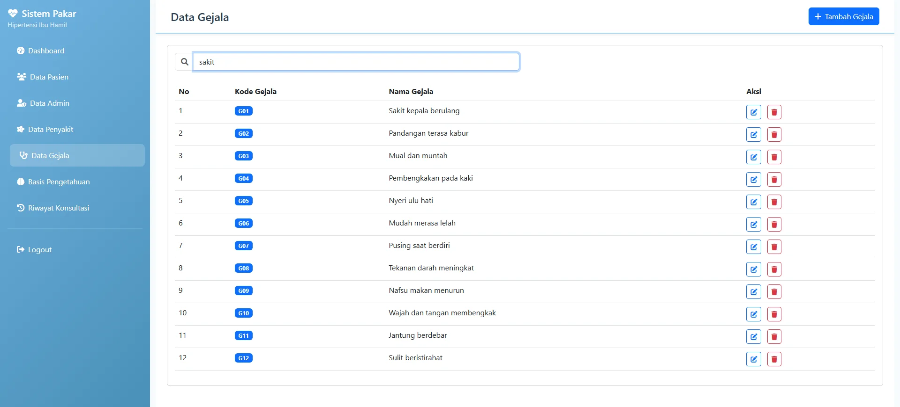
      <br>Daftar gejala dengan pencarian aktif.
    </td>
    <td align="center">
      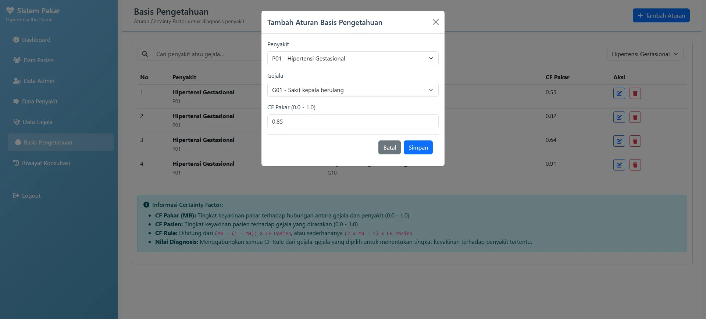
      <br>Basis pengetahuan Certainty Factor dengan filter dan form aturan.
    </td>
  </tr>
  <tr>
    <td align="center">
      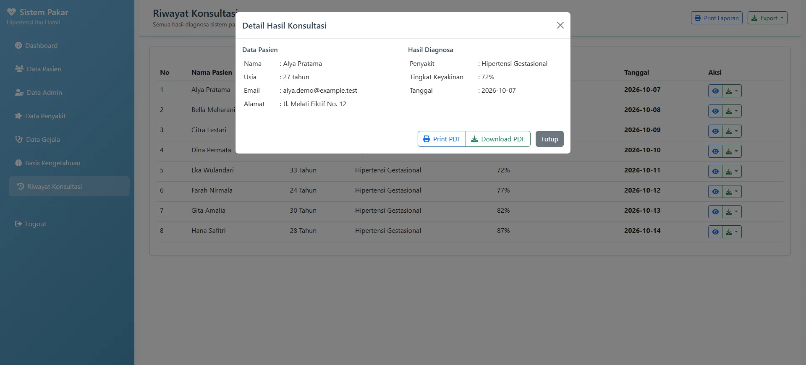
      <br>Riwayat konsultasi dengan modal detail dan opsi laporan.
    </td>
    <td align="center">
      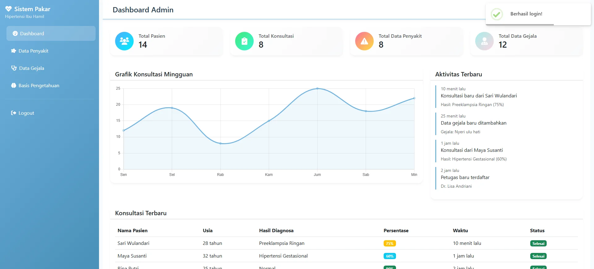
      <br>Dashboard yang dapat diakses oleh role petugas.
    </td>
  </tr>
  <tr>
    <td align="center">
      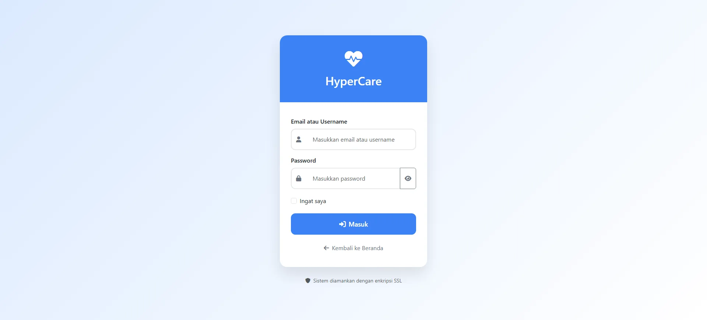
      <br>Halaman login untuk autentikasi pengguna aplikasi.
    </td>
    <td align="center">
      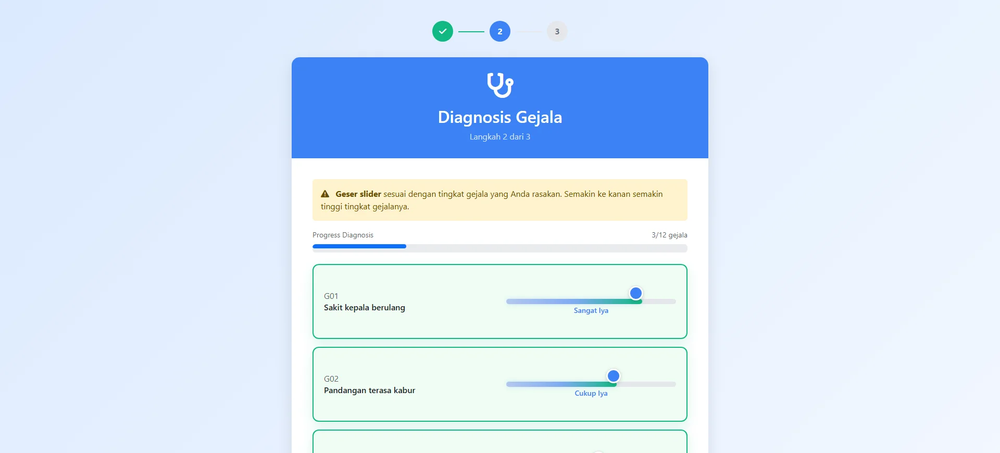
      <br>Form diagnosis dengan gejala dan nilai keyakinan terisi.
    </td>
  </tr>
  <tr>
    <td align="center">
      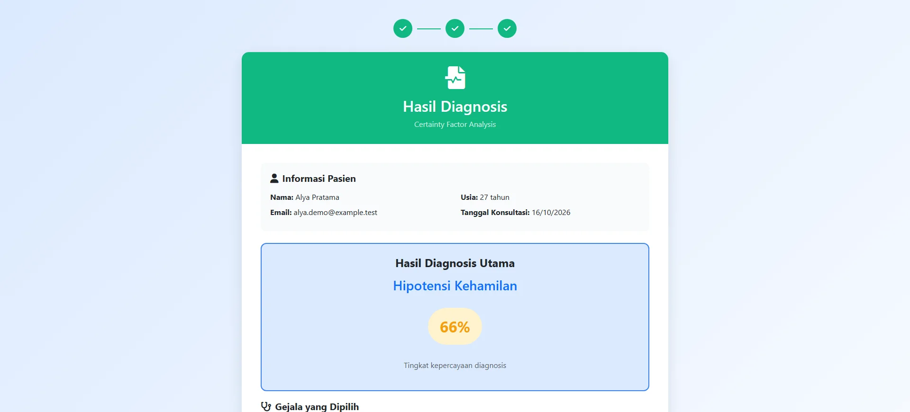
      <br>Hasil diagnosis menampilkan penyakit utama dan tingkat kepercayaan.
    </td>
    <td></td>
  </tr>
</table>

## Teknologi

| Kategori | Teknologi |
| --- | --- |
| Backend | Laravel 10, PHP 8.1+, Laravel Sanctum, Guzzle |
| Template | Blade Templates |
| Frontend | Bootstrap 5, Font Awesome, SweetAlert2 |
| Database | MySQL; SQLite digunakan hanya untuk database screenshot sementara |
| Build tools | Vite, Axios |

## Peran dan Hak Akses

| Peran | Menu dan kemampuan yang ditampilkan |
| --- | --- |
| Admin | Dashboard, data pasien, data admin, penyakit, gejala, basis pengetahuan, dan riwayat konsultasi |
| Petugas | Dashboard, penyakit, gejala, dan basis pengetahuan |
| Publik | Beranda, biodata konsultasi, pengisian gejala, dan hasil diagnosis |

Catatan: tampilan menu membedakan admin dan petugas. Sebelum deployment produksi, pastikan middleware pembatasan role diterapkan pada seluruh route yang sesuai; saat ini group route web menggunakan autentikasi umum dan middleware role tersedia di project tetapi belum dipasang pada group tersebut.

## Instalasi dan Menjalankan Lokal

Prasyarat:

- PHP 8.1 atau lebih baru.
- Composer.
- MySQL.
- Node.js dan npm.

```bash
git clone https://github.com/IrvanAfriandi/sistem-pakar-diagnosis-penyakit-hipertensi-pada-ibu-hamil.git
cd sistem-pakar-diagnosis-penyakit-hipertensi-pada-ibu-hamil
composer install
cp .env.example .env
php artisan key:generate
```

Atur koneksi MySQL pada `.env`, lalu jalankan migrasi dan seeder akun:

```bash
php artisan migrate
php artisan db:seed --class=AdminSeeder
npm install
npm run build
php artisan serve
```

Aplikasi dapat diakses melalui URL yang ditampilkan oleh `php artisan serve`, biasanya `http://127.0.0.1:8000`.

## Akun Demo

Akun berikut dibuat oleh `AdminSeeder` untuk penggunaan lokal. Ganti atau nonaktifkan kredensial ini sebelum deployment produksi.

| Peran | Email | Password |
| --- | --- | --- |
| Admin | `admin123@gmail.com` | `admin1234` |
| Petugas | `petugas123@gmail.com` | `petugas1234` |

## Konfigurasi Penting

Isi variabel berikut sesuai lingkungan lokal atau deployment. README ini tidak menyimpan nilai rahasia.

| Variabel | Fungsi |
| --- | --- |
| `APP_NAME` | Nama aplikasi. |
| `APP_ENV` | Lingkungan aplikasi, misalnya local atau production. |
| `APP_KEY` | Kunci enkripsi aplikasi. Dibuat dengan `php artisan key:generate`. |
| `APP_DEBUG` | Mengatur detail debug; gunakan `false` di production. |
| `APP_URL` | URL dasar aplikasi. |
| `DB_CONNECTION` | Driver database. |
| `DB_HOST`, `DB_PORT` | Host dan port database. |
| `DB_DATABASE`, `DB_USERNAME`, `DB_PASSWORD` | Nama database dan kredensial database. |
| `FILESYSTEM_DISK` | Disk penyimpanan file Laravel. |
| `QUEUE_CONNECTION` | Driver antrean aplikasi. |
| `SESSION_DRIVER`, `SESSION_LIFETIME` | Penyimpanan dan masa berlaku session. |
| `MAIL_MAILER`, `MAIL_HOST`, `MAIL_PORT` | Konfigurasi mail bila fitur mail digunakan. |

## Struktur Folder

```text
app/
├── Http/Controllers/
├── Http/Middleware/
└── Models/
database/
├── migrations/
└── seeders/
resources/
├── views/
├── css/
└── js/
routes/
screenshots/
public/
tests/
```

## Pengujian

Project memiliki test contoh pada `tests/Feature` dan `tests/Unit`. Jalankan dengan:

```bash
php artisan test
```

## Catatan Keamanan

- Jangan commit `.env`, database lokal, log, file upload, atau kredensial produksi.
- Gunakan data dummy untuk pengembangan dan dokumentasi.
- Pastikan pembatasan role diterapkan pada route sebelum aplikasi dipublikasikan ke production.
